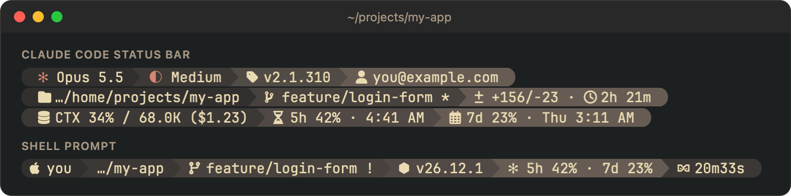
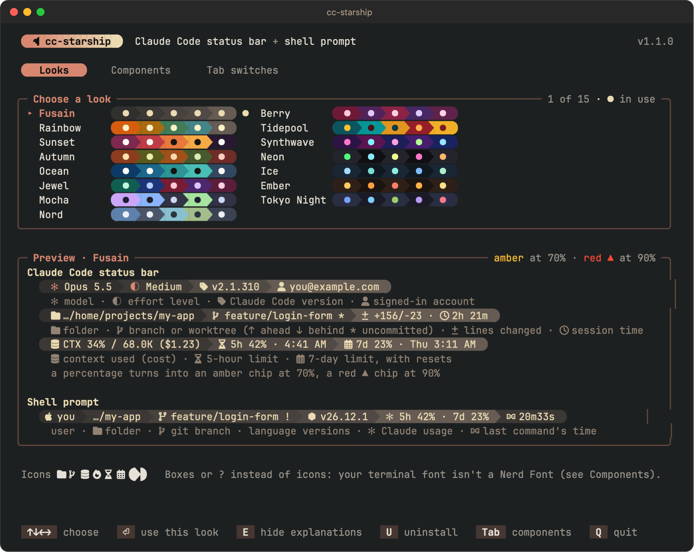
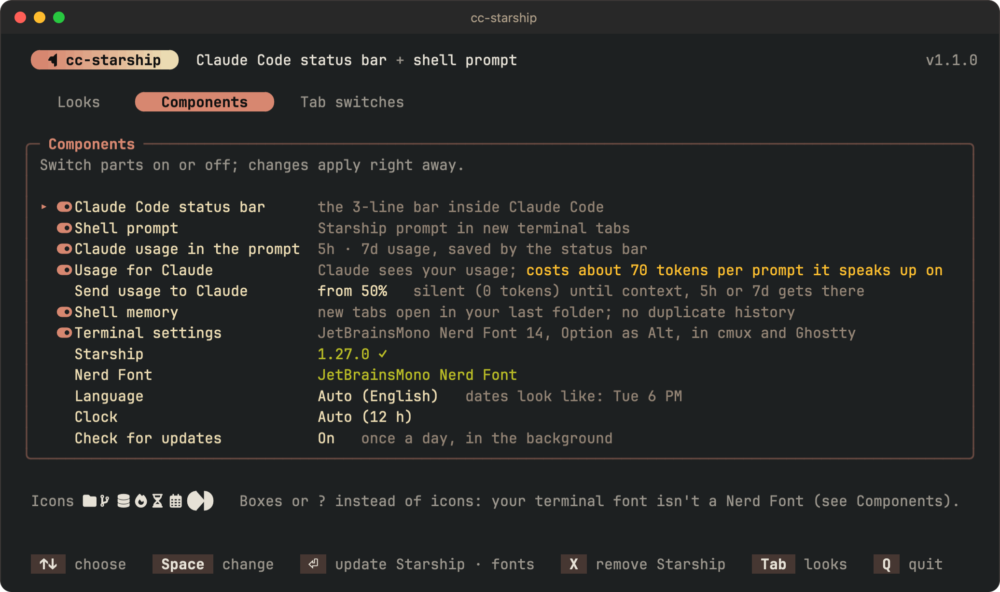
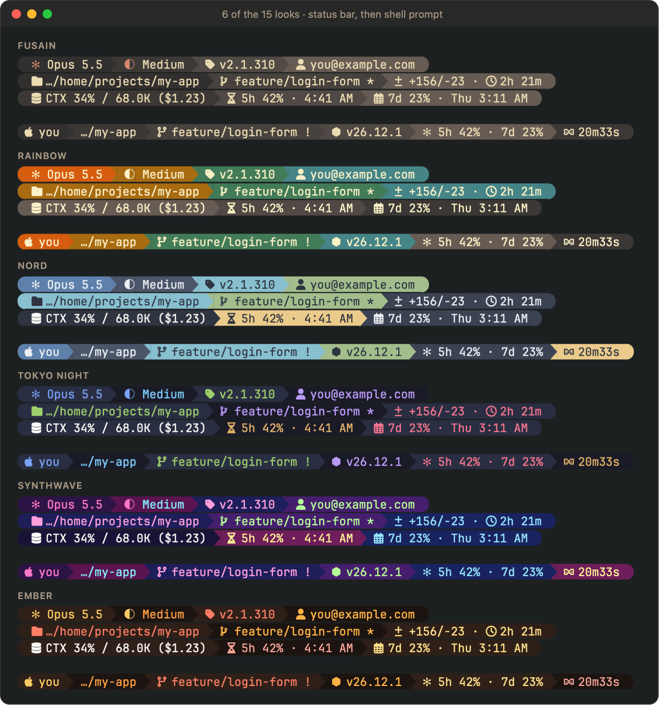
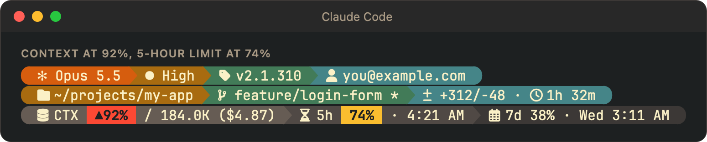
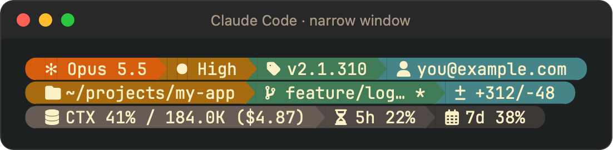

# cc-starship

**A colorful, informative status bar for Claude Code, and a matching prompt for your terminal.**
Both are drawn by [Starship](https://starship.rs). One small program installs everything,
switches looks, and uninstalls cleanly, on macOS and Windows.



- **See what matters while you work:** model, effort, branch, lines changed, how much of the
  context window is used, and your 5-hour and 7-day limits with their reset times.
- **The same look in your terminal**, with your Claude usage right in the prompt.
- **15 looks**, previewed live before you pick one.
- **Turnkey:** installs or updates Starship and a Nerd Font for you. Nothing to configure by hand.
- **Undo is real:** uninstall puts back every file it touched, byte for byte.

---

## Contents

- [Install](#install)
- [Updating](#updating)
- [The control panel](#the-control-panel)
- [Looks](#looks)
- [Reading the status bar](#reading-the-status-bar)
- [Add-ons](#add-ons)
- [Command line](#command-line)
- [What it changes, and how uninstall works](#what-it-changes-and-how-uninstall-works)
- [Speed](#speed)
- [Troubleshooting](#troubleshooting)
- [Development](#development)
- [License](#license)

## Install

1. **Get the program for your computer** from the [Releases](../../releases) page (or build it,
   see [Development](#development)):

   | Computer | File |
   |---|---|
   | Mac with Apple silicon (M1 and later) | `cc-starship-aarch64-apple-darwin` |
   | Mac with Intel | `cc-starship-x86_64-apple-darwin` |
   | Windows (64-bit) | `cc-starship-x86_64-pc-windows-msvc.exe` |

2. **Run it from your terminal**, with no arguments.

   **macOS** (Terminal, iTerm, Ghostty or cmux):

   ```sh
   cd ~/Downloads
   chmod +x cc-starship-aarch64-apple-darwin
   xattr -d com.apple.quarantine cc-starship-aarch64-apple-darwin   # downloaded files are blocked until you allow them
   ./cc-starship-aarch64-apple-darwin
   ```

   **Windows** (Windows Terminal or PowerShell): run
   `.\cc-starship-x86_64-pc-windows-msvc.exe` from your Downloads folder. If SmartScreen
   warns you, choose *More info → Run anyway*.

3. **Pick a look with the arrow keys and press Enter.** The program installs itself, Starship
   and your chosen look.
4. **Open a new terminal tab and restart Claude Code.** That's it.

To change the look later, run the installed copy again:

```sh
~/.local/share/cc-starship/bin/cc-starship                  # macOS
```

```powershell
& "$env:LOCALAPPDATA\cc-starship\bin\cc-starship.exe"      # Windows (PowerShell)
```

## Updating

Once a day, in the background, the program checks GitHub for a newer release. When there is one,
the status bar's third line ends with **cc-starship 1.2.0** (say), and the control panel's header
says it too. The check never slows the status bar: it reads the saved answer, and the check runs
on its own. Turn it off in Components → *Check for updates*, or with `cc-starship prefs updates off`.

To update, download the new file for your computer and open it the same way as the first time.
The panel offers to replace the installed copy; your look and settings stay. From a script:
`cc-starship-… install` does the same without asking.

## The control panel

Run with no arguments, the program opens a keyboard control panel. **Tab** switches between
its two screens.

**Looks**: every look at once, each with a swatch of its colors; the arrow keys browse them,
and the whole panel takes on the colors of the look under the cursor. Below, a live preview of
both the status bar and the prompt, explained part by part (**E** hides the explanations). **Enter** installs with that look, or
switches to it. **U** uninstalls.



**Components**: **Space** switches each part on or off, and changes apply right away. Before
installing, it chooses what gets installed. Here you also update or remove Starship, install a
Nerd Font, and choose the language (English or Québécois French) and clock (24 h or 12 h) for
reset times.



**Q** or **Esc** quits without changing anything. Run the panel from the terminal you normally
use: the preview shows exactly what that terminal and its font will draw.

## Looks

Fifteen looks, chosen for contrast and for colors that stay distinct from each other. Six of them:



All fifteen: **Fusain** (the author's own warm charcoal grays, and the default), Rainbow, Sunset,
Autumn, Ocean, Jewel, Mocha, Nord, Berry, Tidepool, Synthwave, Neon, Ice, Ember, Tokyo Night.
The status bar and the prompt always change together.

## Reading the status bar

| Line | Shows |
|---|---|
| 1 | model · effort level · Claude Code version · signed-in account |
| 2 | folder · branch or worktree (↑ ahead, ↓ behind, `*` uncommitted, `󰙅 2 more` when the repo has other worktrees) · lines added/removed · session time |
| 3 | context used, tokens and cost · 5-hour limit · 7-day limit, each with its reset time |

Reset times read naturally: today shows the time (`2:38 AM`), another day this week its weekday
(`Tue 1:08 AM`), later the date (`Oct 30 6 PM`). In French: `mar. 1 h 08`, `30 oct. 18 h`.

**Warnings stand out:** a percentage becomes an amber chip at 70% and a red ▲ chip at 90%.



**Narrow windows** keep the essentials: each line drops its least useful parts first.



The shell prompt shows your 5-hour and 7-day usage too (`✻ 5h 42% · 7d 23%`), saved by the
status bar each time it refreshes.

## Add-ons

Each is a switch on the Components screen, on by default.

**Usage for Claude.** Lets Claude itself see your context, 5-hour and 7-day numbers (with reset
times and time left), so it can pace long work without you relaying them. It is a Claude Code
`UserPromptSubmit` hook. **It costs about 70 tokens on each prompt it speaks up on**, and the
panel says so before you switch it on. *Send usage to Claude* sets when it starts: every prompt,
or only once context, 5h or 7d reaches 50, 70 or 90% (the default is 50%). Below that it sends
nothing and costs nothing. Restart Claude Code after switching it on.

**Shell memory.** A new tab that opens in your home folder goes back to the last folder you
`cd`'d into, and your history keeps one copy of each command (the newest). Works in zsh and
PowerShell. Tabs that start somewhere specific (restored windows, "Open in Terminal") stay
where they are. Shells run by agents or one-off commands (`ssh host cmd`, `pwsh -Command`) are
left alone. On Windows it uses the Starship prompt.

**Terminal settings.** The same font and keys everywhere: JetBrainsMono Nerd Font, size 14,
and Option working as Alt in cmux and Ghostty. In Windows Terminal it becomes the default font
for every profile. The font is installed if missing (if the download fails, everything else
still installs; get the font later from Components → Nerd Font).

**oh-my-posh.** If it still starts in a profile or draws your status line, install and `status`
say so: two prompt engines conflict, and Starship draws the same kind of prompt about 3× faster.

## Command line

Everything the panel does, for scripts or remote machines:

```sh
cc-starship install [--preset NAME] [--no-starship-update] [--no-hook]
cc-starship theme [NAME]                    # switch look, or show the current one
cc-starship components [bar|shell|usage|hook|memory|terminal] [on|off]
cc-starship prefs [language auto|en|fr-CA] [clock auto|24h|12h] [hook-from 0|50|70|90] [updates on|off]
cc-starship status                          # parts, Starship, Nerd Fonts, notes
cc-starship font list | install ID | remove ID
cc-starship starship update | remove
cc-starship presets | preview [NAME]
cc-starship uninstall
```

`--no-starship-update` keeps the install fully offline when Starship is already there.

## What it changes, and how uninstall works

Before touching a file, install records what was there: the file itself, a link, or nothing.
Uninstall, or switching a part off, uses that record.

| What | Where | Uninstall |
|---|---|---|
| the program, generated configs, backups | `~/.local/share/cc-starship` (Windows: `$env:LOCALAPPDATA\cc-starship`) | removed |
| shell prompt config | `~/.config/starship.toml` | your previous file or link, byte for byte |
| Claude Code `statusLine` and usage hook | `~/.claude/settings.json` | only these taken out; anything else you changed since is kept, your own hooks are never touched |
| Starship start-up line, only if missing | `~/.zshrc`, or each PowerShell `$PROFILE` | the added block removed |
| shell memory | the same profiles, in a block of its own | the block removed |
| Windows PowerShell's script setting, only when it blocks scripts (a new Windows account does, so no profile would run) | your account's execution policy, set to `RemoteSigned` (PowerShell 7's default) | your previous setting, unless you changed it since |
| terminal font and keys | cmux `config.ghostty`, `~/.config/ghostty/config`; Windows Terminal `settings.json` | the block removed; Windows Terminal's face and size put back |
| Nerd Fonts this app installed | your fonts folder (Windows: per user, no admin needed) | removed |
| Starship itself, if missing or outdated | updated through brew, winget or Scoop when they installed it; otherwise the latest release is downloaded into the program folder and its checksum verified | the downloaded one goes with the program folder; one from brew, winget or Scoop stays (`cc-starship starship remove` removes it) |

Settings files with comments are never rewritten: the program stops and says so instead.

## Speed

Measured on real machines. The status bar runs every time Claude Code refreshes, and the prompt
parts run on every command.

| | M1 Pro Mac | M5 Ultra Mac | Windows 11 PC |
|---|---|---|---|
| status bar render | 59 ms | 34 ms | 147 ms |
| usage in the prompt | 28 ms | 20 ms | 65 ms |
| usage for Claude (per message you send) | 39 ms | 27 ms | 85 ms |
| shell memory at tab start | no measurable cost | +6 ms | no measurable cost |

For comparison, the oh-my-posh status bar this replaced took about 94 ms on the M5 Ultra Mac.

## Troubleshooting

- **Boxes or `?` instead of icons:** your terminal's font isn't a Nerd Font. Install one from
  Components → Nerd Font, then choose it in your terminal's settings (or switch on
  *Terminal settings*). macOS Terminal.app's default font has no icons.
- **Nothing changed in Claude Code:** restart it. The status bar updates within a minute, but
  hooks are read only when Claude Code starts.
- **Windows Terminal still shows the old font:** close and reopen it after a new font is installed.
- **"settings.json has comments or trailing commas":** remove them and run install again. Claude
  Code accepts them, but the file can't be safely rewritten with them.
- **An install from the old name (starship-statusline) is found:** the message gives the exact
  command to remove it first. Run that, then install again.

## Development

Written in TypeScript for [Deno](https://deno.com). `deno compile` turns it into one
self-contained program per platform.

```sh
deno task test     # the tests, including install/uninstall round trips in a scratch home
deno task build    # dist/: macOS arm64 and x64, Windows x64
python3 bench.py   # this status bar vs the oh-my-posh one (needs a build)
scripts/screenshots/make.sh   # regenerates docs/images from the real program (macOS)
scripts/conpty/run.sh -k scripts/conpty/keys/smoke-panel.keys --all   # drives the panel on a Windows PC over SSH
```

| Path | Holds |
|---|---|
| `src/main.ts` | the command line |
| `src/tui.ts` | the control panel |
| `src/engine.ts` | install, switch and uninstall, with the manifest of prior state |
| `src/statusline.ts` | the status bar: Claude Code's JSON → Starship |
| `src/hook.ts` · `src/memory.ts` · `src/terminal.ts` | the add-ons |
| `src/starship.ts` · `src/fonts.ts` | Starship and Nerd Font install, update and removal |
| `templates/` · `presets/` | Starship templates and the 15 looks; `deno task gen` embeds them |

Looks come from `scripts/import_ps1_themes.py`. `scripts/preset_metrics.py` prints contrast and
separation numbers for each. Nerd Font glyphs in the sources are written as `\u{...}` escapes,
because raw glyphs are invisible in most editors and easily lost.

The screenshots run the real program in a throwaway demo home (sample project, `you@example.com`,
offline), render its output to HTML and snapshot it with WebKit.

## License

cc-starship is free software: you can use it, study it, change it and share it under the terms of
the [GNU General Public License, version 3 or later](LICENSE). Any copy you share, changed or not,
must stay under the same license, with its source and this notice.

Copyright (C) 2026 iFredOS

It installs or uses other projects under their own licenses: [Starship](https://starship.rs) (ISC),
[Nerd Fonts](https://www.nerdfonts.com) (SIL Open Font License), and the [Deno](https://deno.com)
runtime built into each program (MIT).
